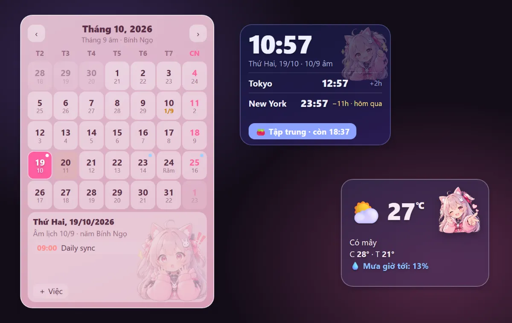
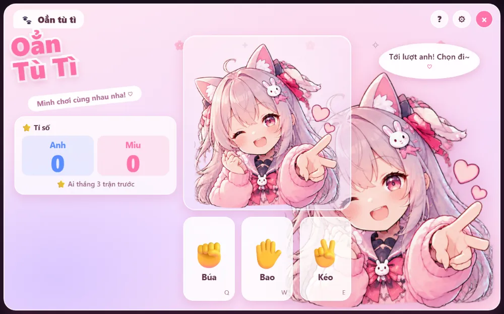
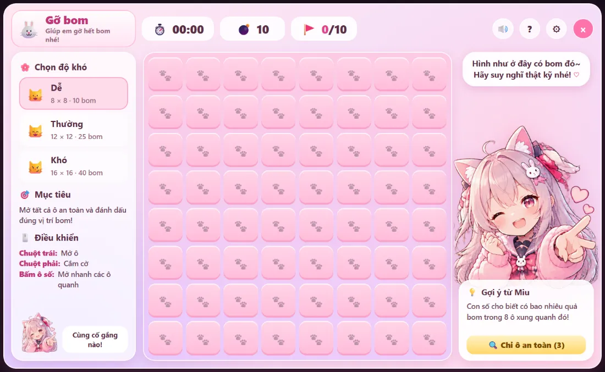
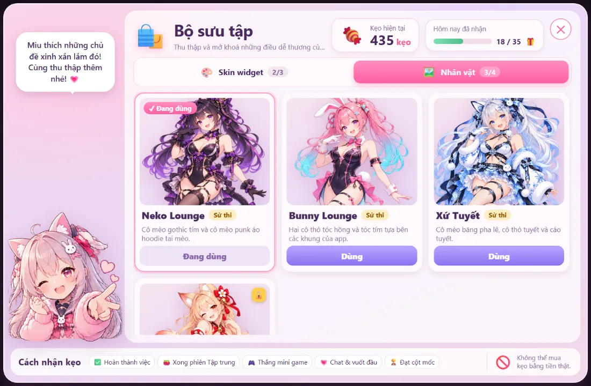
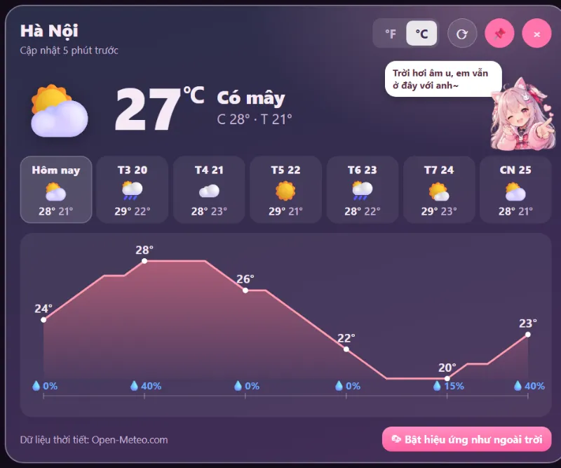
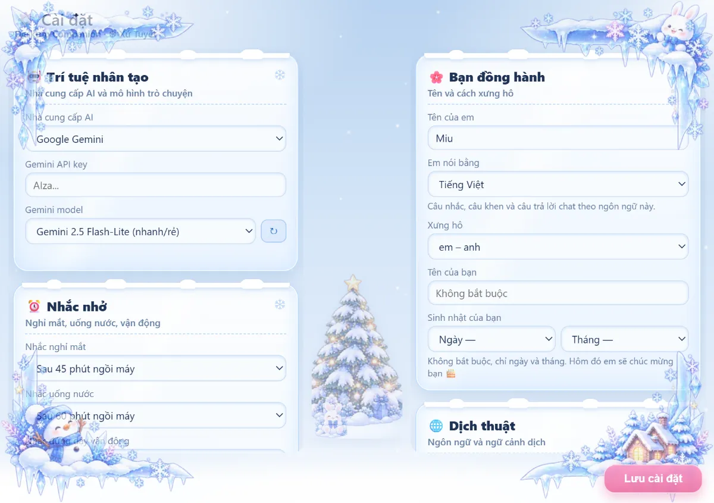
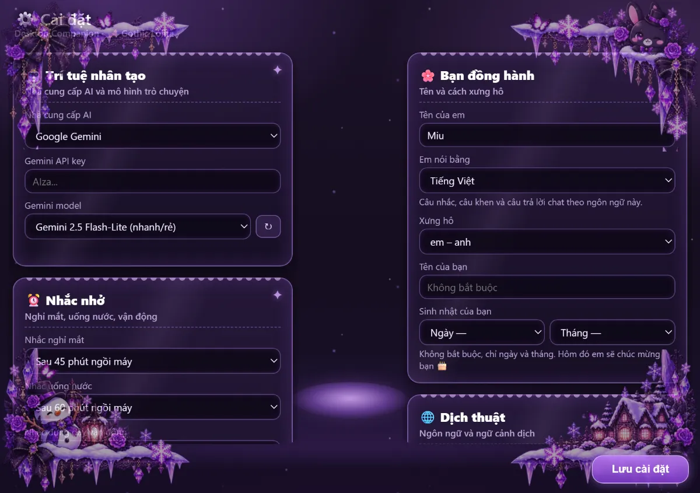

# Desktop Companion

🌸 Thú cưng Live2D trên màn hình Windows (chạy độc lập), tích hợp sẵn **dịch AI**,
**trả lời nhanh** và **lưu công việc** — hoạt động trên mọi ứng dụng (Teams, trình
duyệt, Word…).

🌐 **[Trang giới thiệu (Website) →](https://desktop.techdecoded.net/)**

**Ngôn ngữ:** [English](README.md) · **Tiếng Việt** · [日本語](README.ja.md)


---

## Hình ảnh

<table>
  <tr>
    <td width="50%"><br /><sub>Trang Mini Games</sub></td>
    <td width="50%"><br /><sub>Widget lịch, đồng hồ &amp; thời tiết</sub></td>
  </tr>
  <tr>
    <td><br /><sub>Oẳn tù tì</sub></td>
    <td><br /><sub>Gỡ bom</sub></td>
  </tr>
  <tr>
    <td><br /><sub>🍬 Bộ sưu tập</sub></td>
    <td><br /><sub>Thẻ dự báo thời tiết</sub></td>
  </tr>
  <tr>
    <td><br /><sub>Cài đặt — giao diện ❄️ Xứ Tuyết</sub></td>
    <td><br /><sub>Cài đặt — giao diện 🦇 Gothic Lolita</sub></td>
  </tr>
</table>

<p align="center">
  
  
  
  
  <br /><sub>Bộ nhân vật: 🐰 Bunny · 🐱 Neko · 🦊 Hồ ly · ❄️ Xứ Tuyết</sub>
</p>

<p align="center">
  
  
  
  
  
  
  <br />
  
  
  
  
  
  
  <br /><sub>🎭 Model Live2D trong Bộ sưu tập: Gothic Aristocrat · Pink Angel · Snow Aristocrat · Pink Aristocrat · Gothic Pastel · Pink Pastel · Snow Pastel · Snow Lolita · Gothic Lolita · Snow Dancer · Pink Kawaii · Snow Kawaii</sub>
</p>

---

## Tính năng

- **Pet Live2D trên desktop** — nhân vật trong suốt, luôn nổi trên cùng, kéo-thả
  được, khởi động cùng Windows. Chuột phải để mở **menu xoay tròn**.
- **Dịch** — bôi đen văn bản ở **bất kỳ** ứng dụng nào → bông hoa 🌸 hiện cạnh con
  trỏ → **click** để dịch ngay, hoặc **nhấn giữ** để bung **menu xoay tròn**:
  🌐 dịch nhanh · 📋 sao chép · 💬 trả lời · 💭 hỏi em · 📝 lưu vào task · 🗒️ lưu ghi chú ·
  🗂️ mở bảng đầy đủ.
  Vẫn có thể nhấn **Ctrl+C** (khi bông hoa đang hiện) để sao chép đoạn vừa chọn.
- **Trò chuyện với pet** — chuột phải → 💬 **Chat nhanh**. Câu trả lời hiện dần
  từng chữ trong bong bóng, nét mặt pet đổi theo cảm xúc của câu nói. Pet biết giờ
  và các việc anh chưa làm xong, nhớ 10 lượt gần nhất (chỉ lưu trên máy; 🗑 để xoá),
  và bấm ⏹ để dừng giữa chừng.
- **Hỏi về đoạn đang bôi đen** — chọn 💭 trên menu xoay của bông hoa để mở chat kèm
  sẵn đoạn văn ("giải thích giúp anh", "câu này lịch sự chưa?"…).
- **Tạo task bằng lời** — "nhắc anh gửi báo cáo trước 5 giờ chiều mai" là task được
  thêm kèm hạn chót; "xong báo cáo rồi" là task được đánh dấu xong. Bong bóng chỉ báo
  khi đã lưu thật, và pet hỏi lại chứ không đoán khi chưa chắc là việc nào.
- **Đặt tên cho bạn đồng hành** — pet xin bạn đặt tên (một thẻ nhỏ ngay trên pet),
  cảm ơn bằng chính cái tên đó, rồi hỏi nên xưng hô thế nào: em – anh, em – chị,
  mình – bạn, tớ – cậu, em – sếp, hoặc tự nhập. Pet nói và chat được bằng **tiếng
  Việt, tiếng Nhật hoặc tiếng Anh**; đổi tất cả trong Cài đặt → *Bạn đồng hành*.
- **Pet tự bắt chuyện** — sau một lúc im lặng (Cài đặt: tắt / 30 phút / 1 giờ / 2 giờ)
  pet nói một câu: nhắc việc tồn lâu nhất, hoặc nhắc nghỉ mắt. Pet không nói khi
  không ai nghe: chờ lúc bạn rời máy, khoá màn hình hay đang mở thứ gì toàn màn hình,
  và hai câu tự nói cách nhau ít nhất 10 phút. 🔕 **Đừng làm phiền** (menu xoay hoặc
  tray) cho pet im lặng 1 tiếng.
- **Hạn chót** — bấm 📅 ở mỗi việc. Bảng Công việc xếp việc gấp lên đầu và tô màu
  theo mức gấp. Pet nhắc vào buổi sáng ngày tới hạn, trước 1 giờ, lúc tới hạn, và
  mỗi ngày một lần trong tối đa 3 ngày quá hạn; khi pet đang ẩn hoặc bạn đang trình
  chiếu thì nhắc bằng **thông báo Windows**.
- **Nhắc nghỉ** (bật sẵn, không cần API key) — nghỉ mắt sau 45 phút ngồi máy, uống
  nước và đứng dậy sau 60 phút. Rời máy 5 phút là tính đã nghỉ; các lời nhắc rơi
  gần nhau được gộp thành một câu.
- **Khen khi xong việc** — pet chúc mừng mỗi việc xong, có câu riêng khi xong việc
  cuối cùng, xong trước hạn, và việc thứ 3 / 5 / 10 trong ngày.
- **Ghim task lên desktop** — bấm 📌 để biến việc thành tờ note hồng, cây ghim mang
  mặt nhân vật. Kéo đi đâu cũng được; ✓ đóng dấu xong, ✕ gỡ ghim, 📍 giữ luôn nổi
  trên các cửa sổ khác. Link trong nội dung và ghi chú bấm được.
- **🗒️ Ghi chú thông tin hằng ngày** — bảng riêng (khay, chuột phải → Ghi chú, hoặc
  💞 trên menu tròn) cho những thứ tra hằng ngày: Wi-Fi, số điện thoại, link, lệnh
  hay gõ. Không có hạn, không có "xong". Tìm ngay khi gõ, có dấu hay không dấu đều
  được ("mat khau" ra "Mật khẩu"); ⭐ đưa ghi chú lên đầu, 📋 copy một chạm, ✏️ hoặc
  bấm đúp để sửa tại chỗ. 📌 ghim ghi chú lên desktop thành tờ giấy vàng có sẵn nút
  📋 Copy. Bôi đen ở đâu cũng được, chọn 🗒️ **Lưu ghi chú** trên bông hoa là có
  ngay một ghi chú mới chứa đoạn đó.
- **🛰 Theo dõi website** — thêm tối đa 8 website (Cài đặt → 🛰, có nút Thử ngay),
  widget trên desktop hiện từng site xanh / đỏ kèm thời gian phản hồi. Pet báo khi
  site sập và khi chạy lại, cả bằng thông báo Windows. Chỉ coi là sập sau 2 lần lỗi
  liên tiếp; mọi site cùng lỗi một lúc thì pet chỉ báo "máy mất mạng".
- **🔎 Ô mở nhanh** — **Ctrl+Alt+Space** ở bất kỳ đâu mở ô tìm: gõ tên bookmark,
  `!yt` / `!gh` / `!g` / `!w` / `!map` / `!tr` + từ khoá, địa chỉ web, hoặc chữ bất kỳ
  để tìm trên Google. Tự thêm bang trong Cài đặt. Bookmark nằm ở tab 🔖 của bảng
  Ghi chú.
- **🍅 Phiên Tập trung** — 25 phút tập trung rồi nghỉ 5 phút (chỉnh được). Vòng đếm
  ngược hiện trên pet, pet giữ nét mặt tập trung, và chỉ hạn chót mới được chen ngang.
- **Pet biết khi bạn rời máy** — 10 phút không đụng chuột/phím (hoặc khoá màn hình)
  thì pet ngủ gật, quay lại thì pet chào. Có thêm cảnh báo CPU / RAM cao (mặc định
  tắt). App chỉ đọc trạng thái bật/tắt và phần trăm — không đọc tên cửa sổ, tên ứng
  dụng hay nội dung màn hình. Pet còn nhắc (bật sẵn) khi pin dưới 15% mà chưa cắm
  sạc, nhắc lần nữa ở 5%, và khi ổ cài Windows còn trống dưới 10%.
- **💗 Thân thiết** — ngày có mặt, việc xong, phiên tập trung, chat, vuốt đầu và
  chơi game làm mức thân thiết tăng dần qua 5 cấp (có trần mỗi ngày, không bao giờ
  bị trừ). Mỗi sáng pet chào kèm số việc tới hạn hôm nay, chúc mừng các cột mốc
  (7 / 30 / 100 / 365 ngày, kỷ niệm, chuỗi ngày, lên cấp) và sinh nhật bạn, càng thân
  thì nói chuyện càng tự nhiên.
- **🎮 Mini Games** — trang riêng (💞 → 🎮) với 3 trò, mỗi trò một cửa sổ và Miu phản
  ứng theo từng nước: oẳn tù tì (thắng 3, 5 hoặc 7 trận), đoán số (1–10 tới 1–100, có
  gợi ý) và Gỡ bom (dò mìn 3 cỡ bàn). Cùng trang có "★ Hôm nay" (game của ngày), thành
  tích và số điểm thân thiết đã nhận từ game hôm nay.
- **🌦 Thời tiết** — mưa, tuyết, hoa anh đào, lá bay, sương mù, nắng hay sao đêm
  trên toàn màn hình; không bao giờ chặn chuột, tự dừng khi bạn xem toàn màn hình,
  khoá máy hoặc rời máy. Chọn hiệu ứng, để tự theo mùa & giờ, hoặc theo **thời tiết
  thật** ở thành phố bạn chọn. Có thẻ dự báo (hiện tại, 7 ngày, biểu đồ 24 giờ kèm
  khả năng mưa, °C / °F) và widget thời tiết ghim lên desktop; pet nói một câu khi
  trời đổi và có bản tin buổi sáng. Bật / tắt hiệu ứng bằng **Ctrl+Alt+W**. App
  không dò vị trí của bạn — chỉ gửi toạ độ thành phố bạn chọn tới
  [Open-Meteo](https://open-meteo.com) (không cần API key).
- **📅 Lịch tháng trên màn hình** — ghim một lịch tháng nhỏ từ khay, 💞 → 📅 trên
  menu tròn hoặc Cài đặt. Mỗi ngày có ngày âm lịch, ngày lễ Việt Nam (Tết, Trung
  thu, Giỗ Tổ…) được đánh dấu, ngày nghỉ lễ tô đỏ, ngày có task tới hạn có chấm
  (đỏ khi quá hạn). Bấm một ngày để xem âm lịch đầy đủ, việc tới hạn và sự kiện,
  hoặc **＋ Thêm** một ✓ việc hay 🎗 **sự kiện** vào ngày đó; ngày sinh của bạn có
  🎂. Sự kiện (giỗ, sinh nhật, kỷ niệm) tách riêng khỏi task: không bao giờ quá hạn,
  lặp được **hằng năm theo dương lịch** hoặc **hằng năm theo âm lịch** (tháng nhuận
  không lặp, ngày 30 mà tháng thiếu thì dời về 29). Sự kiện có chấm vàng; bấm vào
  để sửa, đổi qua lại giữa việc và sự kiện, hoặc xoá. Tab 🎗 của bảng Ghi chú liệt
  kê mọi sự kiện theo ngày gần nhất, bấm vào là lịch mở đúng ngày đó. Luôn nổi trên các cửa sổ khác,
  trừ khi bạn tắt 📍. Pet nhắc ngày lễ, Rằm, mùng 1, và tối hôm trước báo mai là
  ngày gì. Khi thêm sự kiện, chọn **nhắc sớm** (trước 1 ngày, 3 ngày, 1 tuần, 10
  ngày hoặc 1 tháng, chọn bao nhiêu cũng được); pet nhắc lúc 7 giờ sáng hôm đó, hoặc
  Windows hiện thông báo. Sự kiện có nhắc sớm mang dấu 🔔. Sáng hôm có sự kiện,
  câu chào đầu ngày của pet cũng nhắc tên nó.
- **🕐 Đồng hồ có giờ thế giới** — giờ máy kèm ngày âm, thêm tối đa 2 đồng hồ
  (Tokyo, Seoul, New York, London…) ghi chênh giờ và "ngày mai" / "hôm qua"; tự
  tính giờ mùa hè. Hàng 🍅 bắt đầu phiên Tập trung và đếm lùi.
- **📊 Thông số máy** — CPU kèm biểu đồ một phút, RAM, dung lượng trống của ổ cài
  Windows, tốc độ tải xuống / tải lên, pin (chỉ máy có pin) và thời gian máy đã
  chạy; cập nhật mỗi 2 giây và chỉ đo khi đang ghim. Thanh chuyển vàng từ 70%, đỏ
  từ 90%, máy rảnh thì Miu ngủ gật. Bấm CPU hoặc RAM để xem 5 ứng dụng dùng nhiều
  nhất (gom như Task Manager), kèm nút mở Task Manager. Tên ứng dụng chỉ được đọc
  khi bảng đó đang mở và chỉ hiện ở đó: không lưu, không gửi đi đâu.
- **🍬 Kẹo & Bộ sưu tập** — xong việc, phiên Tập trung, chat, vuốt đầu, thắng
  game cũng được kẹo (cùng trần mỗi ngày với điểm thân thiết). Đổi kẹo trong 🍬 Bộ
  sưu tập (💞 → 🍬 trên menu tròn) lấy skin widget (Sakura, Trời đêm, Bạc hà, Hoàng
  hôn, Đại dương, Matcha, Kẹo bông, Café latte, Neon đêm), 🎀 trang trí widget (nơ,
  băng washi, cánh hoa anh đào, viền ren, dây sao, mũ tuyết, khung hologram cầu vồng),
  hiệu ứng thưởng (pháo hoa, pháo giấy, mưa hoa anh đào, mưa tim, bong bóng xà phòng,
  sao băng), kiểu bong bóng thoại (Mây, Trái tim, Ren Gothic, Cuộn giấy), bông hoa khi
  bôi chữ (⭐ 🍀 🐾 ❄️), bộ nhân vật (🐰 Bunny, 🐱 Neko, 🦊 Hồ ly, ❄️ Xứ Tuyết), bộ mặt
  Miu (❄️ tuyết, 🦇 Gothic) và model Live2D. Xứ Tuyết, Neko Lounge và Hồ ly còn đổi
  giao diện mọi khung (băng tuyết / Gothic Lolita / đền hồ ly). Chỉ là đồ trang trí;
  không bán bằng tiền thật.
- **🎭 Model Live2D trong Bộ sưu tập** — mười hai nhân vật thêm, ai cũng có biểu cảm
  cười, buồn, giận, ngạc nhiên, ngại, nháy mắt và chuyển động riêng:

  | Model | Giá | Tỉ lệ Capsule |
  |---|---|---|
  | 🦇 Gothic Aristocrat · 🌸 Pink Angel · ❄️ Snow Aristocrat · 🌸 Pink Aristocrat | 10000 🍬 | 0.1% mỗi model |
  | 🦇 Gothic Pastel · 🌸 Pink Pastel · ❄️ Snow Pastel | 7500 🍬 | 0.2% mỗi model |
  | ❄️ Snow Lolita · 🦇 Gothic Lolita · ❄️ Snow Dancer · 🐰 Pink Kawaii · ❄️ Snow Kawaii | 5000 🍬 | 0.4% mỗi model |

  Model không nằm trong bộ cài: mở khoá xong app mới tải về (vài MB, tiến độ hiện
  trên thẻ), kiểm với danh sách có chữ ký, và tự cập nhật khi có bản mới mà không cần
  cập nhật app. Bấm **Dùng** là nhân vật trên màn hình đổi ngay. Hiyori, Haru, Mao,
  Miara vẫn miễn phí, model bạn tự thêm từ thư mục cũng vậy.
- **🎰 Candy Capsule** — quay máy kẹo thỏ trong Bộ sưu tập: 100 🍬 một lượt, 1000 🍬
  mười lượt, tỉ lệ ghi ngay trên máy (Thường 62% · Hiếm 25% · Sử thi 10% · 🌈 Huyền
  thoại 3%, chỉ gồm model Live2D). Lượt thứ 10 chưa ra Hiếm thì chắc chắn từ Hiếm trở
  lên, lượt thứ 50 chưa ra Sử thi thì chắc chắn từ Sử thi trở lên; trùng món được hoàn
  10% giá món đó. Mỗi hạng bung capsule với hiệu ứng riêng, Huyền thoại có tia cầu vồng
  và mưa pháo giấy dày. Đổi thẳng trong cửa hàng vẫn luôn có.
- **🎁 Mỗi ngày một lượt quay miễn phí** — mỗi ngày một viên capsule nhỏ hiện cạnh
  nhân vật; bấm vào là được quay Candy Capsule một lượt miễn phí, mở ngay trên pet.
  Lượt này tính như mọi lượt khác (bảo hiểm, lịch sử, hoàn kẹo khi trùng).
- **🧩 Widget ở một chỗ** — Cài đặt → *🧩 Widget* ghim / gỡ lịch, đồng hồ, widget
  thời tiết, thông số máy, theo dõi website, chọn đồng hồ thêm, và 🧹 xếp gọn mọi widget đang ghim
  thành một cột bên phải. Các widget cùng chiều rộng và lề nên thẳng hàng cả hai mép.
- **Trả lời nhanh** — bôi đen tin nhắn, gõ ý trả lời bằng tiếng Việt, AI soạn câu
  trả lời tự nhiên theo ngôn ngữ của tin nhắn (Anh / Nhật / …).
- **Trợ lý văn bản không cần bôi đen** — chuột phải → 🗂️ **Mở đầy đủ** mở trợ lý
  ngay cạnh pet với ô trống: gõ hoặc dán văn bản rồi dịch, trả lời hay lưu thành task.
- **Lưu công việc** — biến đoạn văn bản bất kỳ thành TODO. Cửa sổ Tasks chia hai
  cột "chưa làm" / "đã làm", ghi lại thời điểm tạo và thời điểm hoàn thành, và
  cho sửa ghi chú của từng việc.
- **Ngữ cảnh dịch** — danh sách ngữ cảnh có sẵn trong Cài đặt (vd: "chat công việc
  trang trọng") để dịch nhanh đúng giọng điệu. Chọn một cái mặc định hoặc không.
- **Pet vào đứng giữa bảng** — mở Cài đặt hoặc Tasks thì pet tự dời vào khoảng
  giữa hai cột (click xuyên qua được nên không vướng tay), đóng hoặc thu nhỏ bảng
  thì pet quay về đúng chỗ cũ.
- **🌸 Bunny Lounge** (tuỳ chọn, Cài đặt → *Diện mạo*) — các cô nàng tựa bên khung
  Cài đặt, Công việc, Trợ lý văn bản, thẻ thời tiết và trang Mini Games; phần đè lên
  bảng mờ đi nên vẫn đọc rõ.
- **Nhìn theo con trỏ** — đầu/mắt nhân vật dõi theo chuột khi chuột ở gần pet.
- **Phóng to / thu nhỏ** — `Ctrl` + lăn chuột để đổi kích thước; tự nhớ kích thước.
- **Menu Diện mạo** — model chưa mở khoá trong Bộ sưu tập có 🔒; chọn vào thì mở
  Bộ sưu tập ở tab Model.
- **Model Live2D tự thêm** — nạp model `*.model3.json` của bạn từ thư mục bất kỳ.
- **Âm thanh** — hiệu ứng tương tác (chọc / vuốt đầu / …) bằng tiếng Nhật / Việt / Anh.
- **Nhà cung cấp AI** — Anthropic Claude hoặc Google Gemini (tự nhập API key của bạn).
  Có thể tải danh sách model trực tiếp từ nhà cung cấp.
- **Phím tắt tùy chỉnh** — đổi phím tắt bắt văn bản (mặc định `Ctrl+Shift+Space`).

---

## Cài đặt

Tải bộ cài mới nhất ở trang [Releases](../../releases):

- **`Desktop Companion_x.y.z_x64-setup.exe`** (NSIS) hoặc **`…_x64_en-US.msi`** (MSI)

Chạy file đó, app sẽ tự khởi động và nằm ở khay hệ thống (system tray).

> Windows cần WebView2 runtime (đã có sẵn trên Windows 10/11).

### macOS (bản thử)

- **`Desktop Companion_x.y.z_universal.dmg`**: một file dùng cho cả Mac Intel lẫn Apple Silicon.

Mở file rồi kéo app vào **Applications**. App chưa được Apple công chứng (notarize)
nên lần đầu mở sẽ báo "bị hỏng" hoặc "không mở được". Chạy lệnh này một lần trong
Terminal rồi mở lại app:

```bash
xattr -dr com.apple.quarantine "/Applications/Desktop Companion.app"
```

Muốn dịch chữ bôi đen ở app khác, app cần quyền **Trợ năng** (Accessibility), vì
nó gửi ⌘C để chép đoạn đang chọn. Lần đầu bạn bôi đen, macOS sẽ hỏi quyền này và pet
chỉ chỗ bật: **Cài đặt hệ thống → Quyền riêng tư & Bảo mật → Trợ năng → Desktop
Companion**. Không cấp quyền thì các tính năng khác vẫn chạy bình thường.

> App chưa ký bằng Apple Developer ID nên sau mỗi lần cập nhật, macOS có thể coi nó
> là app mới. Nếu bôi đen không còn hiện bông hoa, xoá Desktop Companion khỏi danh
> sách Trợ năng bằng nút **−** rồi bật lại.

---

## Bắt đầu

1. **Nhập API key** — icon tray → **Cài đặt** → chọn nhà cung cấp (Anthropic hoặc
   Gemini) → dán key → **Lưu**.
2. **Dịch** — bôi đen văn bản ở đâu cũng được → click bông hoa 🌸.
3. **Trả lời** — bôi đen tin nhắn → nhấn giữ bông hoa → chọn 💬 **Trả lời** → gõ
   tiếng Việt → **Tạo câu trả lời**.
4. **Công việc** — tray → **Tasks**, hoặc chọn 📝 **Lưu vào task** trên menu xoay
   tròn của bông hoa.
5. **Trò chuyện** — chuột phải vào pet → 💬 **Chat nhanh** → gõ → `Enter`.

### Menu tray

Hiện/Ẩn pet · Công việc · 🗒️ Ghi chú · Cài đặt · Bật/Tắt click-through · 🍅 Bắt đầu / dừng tập trung · 🔕 Đừng làm phiền (1 giờ) · 🌦 Bật / tắt hiệu ứng thời tiết · ☁️ Dự báo thời tiết · 📅 Ghim / gỡ lịch tháng · 📊 Ghim / gỡ thông số máy · 🛰 Ghim / gỡ theo dõi website · Thoát

### Chuột phải vào pet

Menu bung thành vòng tròn quanh con trỏ. Rê chuột lên icon nào thì tên hiện ở
viên giữa; bấm vào một nhóm thì vòng đổi sang các mục của nhóm đó và viên giữa
thành nút quay lại.

Diện mạo (đổi model, nhìn theo con trỏ, động tác, chọc) · Âm thanh (giọng nói,
nhạc nền, tắt tiếng) · Chat nhanh · Công việc · Cài đặt (ô dưới cùng) ·
💞 Đồng hành (🍅 tập trung, 💗 thân thiết, 🎮 Mini Games, 🍬 Bộ sưu tập, 🗒️ Ghi chú, 📅 lịch tháng, 📊 thông số máy, 🛰 theo dõi website, 🔕 Đừng làm phiền) ·
☁️ Thời tiết (dự báo, bật / tắt hiệu ứng, ghim lên desktop) · 🗂️ Mở đầy đủ (trợ lý văn bản)

**Model** và **Motion** mở thành hai cột hai bên nhân vật nên vẫn nhìn thấy nhân
vật trong lúc chọn. Bảng mở xuyên suốt nhiều lựa chọn — đóng bằng × hoặc `Esc`.

---

## Build từ mã nguồn

### Yêu cầu

- [Rust](https://rustup.rs) (stable) + MSVC C++ build tools
- [Node.js](https://nodejs.org) 18+
- Yêu cầu Tauri — xem <https://v2.tauri.app/start/prerequisites/>

### Lệnh

```bash
npm install
npm run dev      # chạy chế độ phát triển
npm run build    # tạo bộ cài trong src-tauri/target/release/bundle/
npm test         # test JS (app/js/*.test.js)
cd src-tauri && cargo test   # test Rust
```

---

## Công nghệ

- **[Tauri 2](https://tauri.app)** (lõi Rust + WebView2)
- **Live2D Cubism 4** render bằng **[PIXI.js](https://pixijs.com)**
- Global mouse hook + giả lập copy để bắt văn bản xuyên ứng dụng (Windows)
- API HTTP của Anthropic / Gemini cho dịch & trả lời
- [Open-Meteo](https://open-meteo.com) cho dự báo thời tiết và tìm thành phố

---

## Ghi công

- Model mẫu Live2D © Live2D Inc. (dùng theo Free Material License).
- Dữ liệu thời tiết: [Open-Meteo.com](https://open-meteo.com) (CC BY 4.0).
- Xây trên runtime render của dự án Anime Companion.

## Giấy phép

- **Mã nguồn:** MIT — xem [LICENSE](LICENSE).
- **Art gốc** (các model Live2D trong Bộ sưu tập, nhân vật bám mép, bộ mặt Miu, ảnh Arcade): [CC BY-NC 4.0](https://creativecommons.org/licenses/by-nc/4.0/deed.vi) — được chia sẻ và chỉnh sửa nếu ghi tên tác giả, không dùng thương mại. Xem [ASSETS-LICENSE.md](ASSETS-LICENSE.md).
- **Model mẫu Live2D** (Hiyori, Haru, Mao, Miara): © Live2D Inc., Free Material License.
